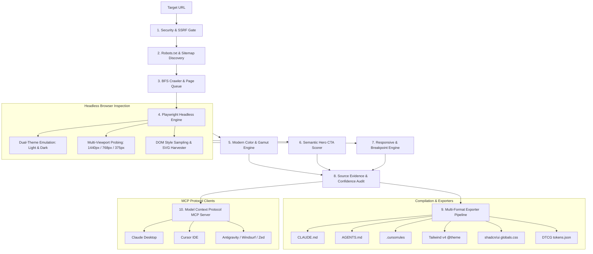
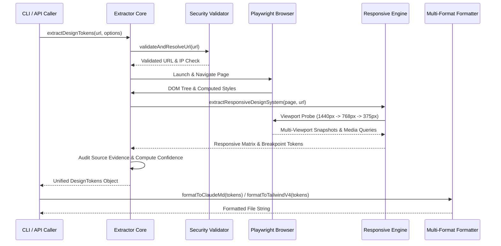

# Styleprobe — Technical Architecture & Pipeline Specification

`styleprobe` is an automated visual design system extraction engine designed to reverse-engineer live websites and compile them into structured, verified design tokens and AI agent instruction files (**CLAUDE.md, AGENTS.md, .cursorrules**).

---

## 1. High-Level System Architecture

---

## 2. Pipeline Subsystems

### 2.1 Security & Network Protection Layer (`src/security.ts`)
Before any network connection or browser navigation occurs, target URLs are validated against enterprise SSRF and security controls:
- **SSRF Defense**: Rejects loopback (`127.0.0.0/8`, `::1`), RFC 1918 private subnets (`10.0.0.0/8`, `172.16.0.0/12`, `192.168.0.0/16`), link-local (`169.254.0.0/16`, `fe80::/10`), IPv4-mapped IPv6 addresses, and cloud provider metadata services (`169.254.169.254`, `metadata.google.internal`).
- **DNS Rebinding Protection**: Resolves target hostnames to IP addresses using native DNS lookup and validates the resolved IP before socket connection.
- **Protocol & Port Whitelist**: Restricts schemes strictly to `http:` and `https:`. Blocks sensitive non-web ports (SSH 22, SMTP 25, Redis 6379, etc.).
- **Per-Hop Redirect Interception**: Hooks into Playwright route interception (`page.route('**/*')`) and HTTP client redirect chains, re-validating security constraints on every redirect hop to prevent redirect-based SSRF.
- **Resource Constraints**: Strict document fetch limits (e.g. max 5MB for sitemaps, execution timeouts, bounded page crawl budgets).

### 2.2 Discovery, Robots & Crawler Subsystem (`src/robots.ts`, `src/sitemap.ts`)
- **RFC 9309 Robots Parser**: Supports standard user-agent matching, wildcard patterns (`*`), and end-anchors (`$`). Enforces longest-match precedence rules. Fails open gracefully on HTTP 4xx/5xx or unreachable robots files.
- **Sitemap Index Recursion**: Discovers XML sitemaps from `robots.txt` or standard paths (`/sitemap.xml`). Recursively navigates sitemap indexes with cycle detection, redirect loop prevention, and a hard document fetch limit (`MAX_SITEMAP_DOCS_FETCHED = 8`).
- **Breadth-First Search (BFS) Crawler**: Employs monotonic depth tracking (all depth $d$ pages precede depth $d+1$). Seeds sitemap URLs at depth 1. Preserves RFC 3986 path and parameter casing while stripping tracking query parameters (`utm_*`, `ref`, `fbclid`).

### 2.3 Headless Browser Inspection Engine (`src/extractor.ts`)
- **Dual-Theme Isolation**: Inspects both light and dark modes within a single pass by invoking `page.emulateMedia({ colorScheme: 'dark' })` and testing data attributes (`[data-theme="dark"]`, `.dark`).
- **CSS Custom Property Tracking**: Extracts declared CSS custom properties in `:root` and matches them to DOM elements where they are applied.
- **Representative Component Sampling**: Evaluates computed styles for buttons, cards, inputs, navigation bars, and badges.
- **Brand SVG Harvester**: Scans rendered inline SVGs, computes aspect ratios, and extracts vector assets.

### 2.4 Modern CSS Colors & Semantic CTA Scoring (`src/analyzer.ts`, `src/colors.ts`)
- **Modern Color Spaces**: Parses wide-gamut CSS color declarations including **OKLCH**, **OKLAB**, **Display-P3**, **CIE LAB**, and **CIE LCH**.
- **Gamut Mapping**: Converts wide-gamut coordinates into standard sRGB with safe clamping to prevent NaN or color distortion.
- **Semantic CTA Scoring**: Primary CTA selection relies on deterministic multi-factor scoring:
  $$\text{Score} = w_1 \cdot \text{Geometry} + w_2 \cdot \text{ViewportPosition} + w_3 \cdot \text{SemanticRole} + w_4 \cdot \text{Contrast}$$
  Filters out non-interactive elements (spans, labels) and deprioritizes navbar utilities (search inputs, language dropdowns, theme toggles).

### 2.5 Multi-Viewport Responsive Probing Engine (`src/responsive.ts`)
- **Viewport Triangulation**: Probes the page at three standardized breakpoints:
  - **Desktop**: 1440×900 px
  - **Tablet**: 768×1024 px
  - **Mobile**: 375×812 px
- **Media Query Extraction**: Scans `document.styleSheets`, inline `<style>` tags, and `<link rel="stylesheet" media="...">`. Supports CSS Media Queries Level 4 range queries (`width >= 960px`, `width <= 639px`) alongside classic `min-width` / `max-width`.
- **Fluid Typography Detection**: Identifies fluid `clamp()`, `min()`, `max()`, and viewport-unit (`vw`/`vh`) font scaling formulas.
- **Cross-Viewport Comparison Matrix**: Compares H1 font size, section padding, grid columns, navigation mode, card gap, and button touch targets across viewports.

### 2.6 Source Evidence & Confidence Subsystem (`src/types.ts`)
Every extracted token is audited with verifiable provenance:
- **`TokenEvidence`**: Records source type (`css-variable`, `computed-style`, `media-query`, or `dom-sampling`), selector, rule text, and audit reasoning.
- **`DesignSystemConfidenceReport`**: Computes an aggregate score ($0–100$) and categorical ratings (`HIGH`, `MEDIUM`, `LOW`):
  - **HIGH**: Token is directly verified by an explicit CSS variable or computed hero element.
  - **MEDIUM**: Token is inferred from dominant multi-element DOM consensus.
  - **LOW**: Inferred fallback or default.

### 2.7 Multi-Format Compilation Pipeline (`src/formatter.ts`)
Compiles unified `DesignTokens` into production-ready formats:
- **AI Coding Agent Contexts**: `CLAUDE.md`, `AGENTS.md`, and `.cursorrules` with **strict negative constraints** forbidding style hallucination.
- **Styling Frameworks**: Modern Tailwind v4 `@theme`, Tailwind v3 CommonJS, `shadcn/ui` globals.css, DTCG / Figma JSON, and CSS custom properties.
- **Full Markdown Report**: Includes dual-theme color tables, typography scale, responsive matrix, component specs, and Section 9 (Confidence & Source Evidence Report).

### 2.8 Model Context Protocol (MCP) Server Layer (`src/mcp.ts`)
Exposes live extraction primitives directly over standard I/O (stdio) via the JSON-RPC 2.0 Model Context Protocol:
- **Interactive Tools**:
  - `probe_design_system`: Comprehensive design extraction with format selection and crawl depth.
  - `extract_colors`: Dual-theme palette, primary CTA resolution, and contrast ratios.
  - `extract_typography`: Heading hierarchy, body scales, and fluid `clamp()` detection.
  - `extract_responsive_matrix`: Cross-viewport property comparison (1440px / 768px / 375px) and custom media queries.
  - `generate_agent_rules`: Production-ready instructions (`CLAUDE.md`, `.cursorrules`, `AGENTS.md`) with negative constraints.
  - `audit_design_system`: Consistency scoring, extraction confidence ($0–100$), and evidence audit.
- **MCP Prompts**: `recreate-component` template instructing coding agents to build pixel-accurate React components matching target sites.
- **MCP Resources**: `styleprobe://formats` cataloging supported output formats and configurations.
- **Security Boundary**: Enforces SSRF and network validation prior to tool execution, returning structured error messages (`isError: true`) on policy rejection.

---

## 3. Data Flow & Token Aggregation

---

## 4. Error Handling & Resilience
- **SSRF Violations**: Immediate termination before network fetch; returns actionable security errors.
- **Robots / Sitemap Failures**: Fails open gracefully, continuing crawl without stalling.
- **Cross-Origin Stylesheets**: If CORS prevents reading `sheet.cssRules`, the engine falls back to multi-viewport computed style probing and inline `<style>` parsing.
- **Page Timeouts**: Bounded per-page timeouts ensure slow third-party analytics scripts do not block token extraction.
